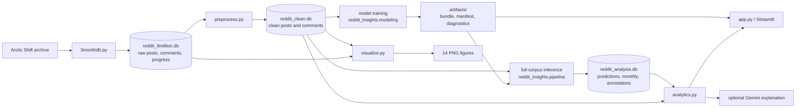

# Reddit Sentiment Analysis Engine: detailed project guide

This guide describes the **implemented code and the files currently present in this workspace**. It follows a record from archive collection through cleaning, model training, full-corpus inference, analysis, and the Streamlit dashboard. It also explains the design choices that can be inferred from the code and the limits of the resulting claims.

The academic [project synopsis](project_synopsis.txt) describes the research goal. Some of its claims are broader than the running implementation. Where the two differ, this guide follows the Python code, database schemas, tests, and saved artifact metadata. Counts and model scores below describe the **current saved snapshot**, not guarantees for a new collection or training run.

## Contents

1. [What the project does](#1-what-the-project-does)
2. [Repository map](#2-repository-map)
3. [Historical collection](#3-historical-collection-3monthdbpy)
4. [Configurable alternative collector](#4-configurable-alternative-collector-arctic_shift_dbpy)
5. [Cleaning and feature engineering](#5-cleaning-and-feature-engineering-preprocesspy)
6. [Sentiment and topic modeling](#6-sentiment-and-topic-modeling)
7. [Full-corpus inference and the analysis database](#7-full-corpus-inference-and-the-analysis-database)
8. [Analytics and formulas](#8-analytics-what-each-number-means)
9. [Streamlit dashboard](#9-streamlit-dashboard-shared-behavior)
10. [Static visualizations](#10-static-report-visualizations)
11. [Design tradeoffs](#11-design-decisions-and-their-practical-tradeoffs)
12. [Tests](#12-what-the-existing-tests-verify)
13. [How to run and rebuild](#13-how-to-run-and-rebuild)
14. [Limits and discrepancies](#14-limits-discrepancies-and-interpretation)

## 1. What the project does

The project analyzes archived Reddit posts and comments from 25 communities in three broad domains: technology, science, and news/general discussion. Its main path:

1. Collects historical posts and comments from the Arctic Shift archive into SQLite.
2. Removes unusable entries, cleans text, and adds time, domain, and engagement features.
3. Samples cleaned records and uses VADER to create **weak sentiment labels**: negative, neutral, or positive.
4. Trains four classifiers to imitate those VADER labels and fits an LDA topic model.
5. Applies VADER, all four classifiers, and LDA to every cleaned record; stores record-level predictions and compact monthly aggregates in a separate analysis database.
6. Presents trends, topics, community comparisons, record inspection, model diagnostics, and optional AI explanations in a local Streamlit dashboard.
7. Separately generates 14 static figures for reports.

It is an **archive analysis system**, not a live Reddit monitor. The collector takes chronologically early records up to monthly quotas, so its record counts do not measure total Reddit activity. A sentiment label measures the tone the model assigns to text; it does not establish factual truth, representative public opinion, or why a trend changed.

### Architecture and data flow



There is a **second collector**, [arctic_shift_db.py](arctic_shift_db.py), which writes `reddit_archive.db` by default. It is a configurable research collection tool with a different schema. It is not the direct input expected by [preprocess.py](preprocess.py).

## 2. Repository map

| Path | Responsibility |
| --- | --- |
| [3monthdb.py](3monthdb.py) | Fixed, large historical collection used to produce `reddit_8million.db`. Despite the filename, its configured span is roughly four years. |
| [arctic_shift_db.py](arctic_shift_db.py) | Separate command-line collector for chosen communities and date windows. |
| [preprocess.py](preprocess.py) | Converts the large raw database to `reddit_clean.db`; derives text, calendar, domain, and score features. |
| [reddit_insights/text.py](reddit_insights/text.py) | Light sentiment text preparation, VADER scoring, and text fingerprints. |
| [reddit_insights/modeling.py](reddit_insights/modeling.py) | Sampling, weak-label training, evaluation, LDA training, and saved model artifacts. |
| [reddit_insights/storage.py](reddit_insights/storage.py) | SQLite connection rules, source identity, analysis schema, and metadata. |
| [reddit_insights/pipeline.py](reddit_insights/pipeline.py) | Resumable full-corpus inference and command-line interface. |
| [reddit_insights/analytics.py](reddit_insights/analytics.py) | Parameterized aggregate queries, trend formulas, record exploration, annotations, and safe CSV export. |
| [reddit_insights/jobs.py](reddit_insights/jobs.py) | Starts the pipeline from the dashboard as a background process and reads its log tail. |
| [reddit_insights/assistant.py](reddit_insights/assistant.py) | Optional structured Gemini explanation over an explicit evidence package. |
| [app.py](app.py) | The eight-view Streamlit dashboard. |
| [visualize.py](visualize.py) | Standalone report figure generator using both raw and clean databases. |
| [visualization_guide.txt](visualization_guide.txt), [visualizations/README.txt](visualizations/README.txt) | Existing explanations of the static figures and saved dataset. |
| [requirements.txt](requirements.txt), [howToRun.txt](howToRun.txt) | Main dashboard dependencies and a Windows launch command. |
| [tests](tests) | Unit and integration checks for collectors, analytics, inference, assistant, and dashboard. |
| [artifacts](artifacts) | Saved model bundle, training manifest, disagreement examples, sample index, and pipeline state/logs. |
| `.streamlit/config.toml` | Local Streamlit server and visual theme settings. |

The `.db` files are large local data artifacts. The current workspace has `reddit_8million.db`, `reddit_clean.db`, and `reddit_analysis.db`. The [`.gitignore`](.gitignore) excludes databases, model artifacts, virtual environments, logs, and `.streamlit/secrets.toml`; their presence in this workspace does not mean they should be committed.

### Terms used throughout

- **Record**: one archived post or comment. A record is not a Reddit user, conversation, or unique opinion.
- **Kind**: `post` or `comment`. Both are analyzed, and their IDs may overlap, so the analysis key includes the kind.
- **Category/domain**: a fixed community grouping (`technology`, `science`, `news_general`, or fallback `other`). It comes from the subreddit name, not text classification.
- **Score**: the archived Reddit score. This is an engagement field and is **not** sentiment.
- **Compound**: VADER's continuous score, mapped by thresholds to three sentiment classes.
- **Topic**: the largest component of an LDA document-topic distribution. `-1` means the text contains no term in the topic vocabulary.
- **Percentage point (pp)**: the arithmetic difference between two percentages; for example, 40% minus 25% is 15 pp.

## 3. Historical collection: `3monthdb.py`

This is the collector that feeds the main pipeline. The filename is historical: the constants in the current script specify **2022-08-18 through 2026-08-18**, with the end exclusive. `get_month_windows` splits that range at calendar month boundaries, producing 49 windows because the first and last calendar months are partial. The script covers 25 named subreddits. Its configured quota is **1,000 posts and 6,000 comments per subreddit per window**, or a theoretical 8,575,000 records across all windows. A quota is an upper target, not proof that every window contains that much accessible data.

### Collection settings and request behavior

The script has constants rather than command-line options. It sends requests to the Arctic Shift archive for posts and comments, requests only its selected fields, sorts ascending by creation timestamp, and uses `limit=auto`. A successful page is followed by a 0.25-second delay. Requests have a 120-second timeout; selected HTTP and network failures are retried up to seven attempts with backoff. A `requests.Session` reuses connections. These choices reduce request overhead and help a long archive run tolerate temporary failures.

For each subreddit, month window, and resource type, the collector fetches pages until it reaches that resource's quota or sees no further page. It truncates a page at the remaining quota, writes records with `INSERT OR REPLACE`, and saves the latest timestamp and count to a `progress` row after every page. On restart it skips completed windows and resumes incomplete ones from the saved cursor. A repeated record can be replaced without creating a duplicate because its Reddit ID is the primary key. SQLite uses WAL journaling and `synchronous=NORMAL`, plus larger in-memory/cache settings, to make repeated batches practical.

`reddit_8million.db` has separate `posts`, `comments`, and `progress` tables. Post rows retain the Reddit ID, subreddit, creation/retrieval times, title, self text, URL, score, comment count, and NSFW/spoiler flags. Comment rows retain ID, subreddit, times, body, linked post/parent IDs, score, and distinguished status. Indexes support subreddit/time and comment link queries. `progress` is keyed by subreddit, resource, and window so the collector can resume one slice independently of the others.

**Why this shape?** Monthly windows put a finite bound on each slice, permit progress to survive interruption, and spread the sample across communities and periods. Ascending order and a per-window cap make volume predictable. The tradeoff is selection bias: each slice contains earlier available records, not a random or exhaustive sample. Even when all `progress` rows say completed, that only says the collector stopped each slice; it does not prove full archive coverage. The current fetch function can return an empty list after a terminal request failure, and the caller can treat that like genuine exhaustion. If a page lacks timestamps or its newest timestamp fails to advance, the loop also stops and subsequently marks that slice complete. Pagination based only on timestamps can be ambiguous when several records share a second. `records_collected` counts fetched/accepted work and can differ from distinct stored rows after replacements or skipped IDs.

The current saved raw database contains **1,113,687 posts and 7,039,064 comments, 8,152,751 records total**. Its 2,450 progress slices (25 communities × 49 windows × 2 kinds) are marked complete. These are observations of this saved database, not an assurance that the archive was complete or that every request succeeded.

## 4. Configurable alternative collector: `arctic_shift_db.py`

This script is useful when the researcher wants to choose communities and dates on the command line. It has two commands:

```powershell
.venv\Scripts\python.exe arctic_shift_db.py init-db --database reddit_archive.db
.venv\Scripts\python.exe arctic_shift_db.py collect --database reddit_archive.db --subreddit science --after 2025-01-01 --before 2025-02-01 --resume
```

`--subreddit` can be repeated. `--after` is inclusive and `--before` is exclusive. Omitting `--resource` collects both `posts` and `comments`; repeat `--resource posts` or `--resource comments` to select one or both explicitly. Defaults are 100 records per page, at most 100 pages per subreddit/resource, and at least one second between requests. The page size must be 1–100. `--resume` continues a matching checkpoint.

Unlike the fixed collector, this one records `collection_runs`, `sync_checkpoints`, and `ingestion_errors` as well as normalized `subreddits`, `posts`, and `comments`. It normalizes Reddit IDs, strips `t1_`/`t3_` prefixes where appropriate, tracks first and most recent ingestion times, and upserts mutable fields. It checks that the archive response contains a data list, applies a custom user agent, and retries rate limits, selected server failures, network failures, and invalid JSON. A checkpoint is saved per page; reaching `--max-pages` is reported as **partial** rather than complete. Per-resource errors are logged while other items continue, and the command exits nonzero when such errors occur.

This more configurable design improves auditability for smaller, targeted research pulls. There are still limits: the reported record count includes accepted upserts, not just new rows; a run can be labeled `completed` while some items are partial at the page cap; an unexpected uncaught exception can leave a run marked running; and timestamp-only pagination may miss tied timestamps, depending on archive behavior. Its database schema differs from `reddit_8million.db`, so `preprocess.py` cannot simply be pointed at it without a conversion or code change.

## 5. Cleaning and feature engineering: `preprocess.py`

`preprocess.py` opens `reddit_8million.db` read-only and writes `reddit_clean.db` in batches of 50,000. Its paths are module constants (`SOURCE_DB` and `CLEAN_DB`). The raw archive remains untouched; the derived database is the input required by training and analysis.

### Which rows survive?

- For posts, the SQL selection excludes a missing/empty title and deleted or removed self text. A link-only post with a usable title can still be kept when its self text is empty.
- For comments, the SQL selection excludes empty, `[deleted]`, and `[removed]` bodies.
- After text cleaning, either kind is dropped if it has fewer than three whitespace-delimited words. This removes many placeholders, emoji-only entries, and very short fragments.
- `INSERT OR IGNORE` prevents duplicate primary-key IDs from being inserted into the clean tables. The script's `written` counters count attempted output rows, so on reruns they need not equal newly inserted rows.

### How `text_clean` is made

The cleaning sequence HTML-decodes entities, removes fenced code blocks, unwraps inline code and common Markdown formatting, removes quotes/headings markers, strips URLs and Reddit user/subreddit mentions, strips a broad emoji/Unicode range, applies Unicode NFKD normalization, lowercases, and collapses whitespace. The same cleaned text is used for word counts, lengths, keyword search, and topic modeling. The original title/self text or comment body is retained in separate raw columns so a reader can inspect source wording.

The broad `U+10000–U+10FFFF` pattern also removes supplementary Unicode characters that are not emoji. The script defines Reddit stopword and negation-word sets, but **does not actually apply them**. Its word count is a simple whitespace split; there is no stemming, lemmatization, language detection, or NLTK/spaCy processing in this file. This matters because the synopsis describes several of those steps as research goals. Topic modeling later uses its own stopword list; sentiment inference deliberately uses another, lighter text path.

### Derived columns and why they help

Both clean tables carry subreddit, fixed category, UTC creation time, `date`, `year`, `month`, `year_month`, day of week, hour of day, weekend flag, `text_clean`, character length, word count, archived score, and score bucket. These precomputed fields make month and community slicing, activity heatmaps, and data-quality charts much cheaper than repeatedly parsing timestamps and text in the dashboard.

Posts additionally carry raw title/self text, `post_type` (`self` or title-only/link), `has_url`, archived comment count, NSFW flag, and spoiler flag. Comments carry raw body, normalized post and parent IDs, and distinguished status. The score buckets are **negative**, **zero**, **low (1–10)**, **medium (11–100)**, **high (101–1,000)**, and **viral (>1,000)**. They describe engagement, not emotional polarity. The URL flag is a simple heuristic, so it is not a complete link classifier.

The subreddit-to-category mapping is case-insensitive and covers the 25 configured communities; unknown names become `other`. This stable, explicit grouping supports domain comparisons without running another classifier. SQLite indexes on subreddit, category, month, creation time, and comment `post_id` accelerate common filters. `preprocessing_meta` stores the source name, processed time, row counters, skipped-short counters, and duration.

| Current saved stage | Posts | Comments | Total |
| --- | ---: | ---: | ---: |
| Raw archive | 1,113,687 | 7,039,064 | 8,152,751 |
| Read after SQL placeholder/empty filtering | 747,407 | 6,366,111 | 7,113,518 |
| Clean output tables | 731,146 | 6,054,947 | 6,786,093 |
| Too short after cleaning, within selected rows | 16,261 | 311,164 | 327,425 |

These numbers come from the present databases and `preprocessing_meta`. The clean rows match the attempted write counters in this snapshot. Reprocessing into an existing clean database does **not** refresh previously inserted IDs because of `INSERT OR IGNORE`; use a newly created output database when a fresh derivation is required.

## 6. Sentiment and topic modeling

The analysis code keeps two deliberately different views of text:

| Use | Input and transformation | Reason |
| --- | --- | --- |
| Sentiment/VADER and classifiers | Post title plus self text, or comment body; HTML-decoded, URLs and user mentions removed, whitespace normalized, then capped at 8,000 characters. Capitals, punctuation, emoji, and negation are retained. | VADER uses emphasis, punctuation, and informal expression; stripping all of that would discard sentiment cues. The cap bounds inference cost. |
| LDA topics | `text_clean` from preprocessing, then a count vectorizer with English and Reddit-specific stopwords and 3+ letter ASCII terms. | Topic modeling seeks recurring content words, where common function words and archive boilerplate are usually noise. |

### VADER as teacher, not ground truth

VADER produces a compound score. The implementation maps scores **at or below -0.05** to negative (`0`), scores **at or above +0.05** to positive (`2`), and scores strictly between those thresholds to neutral (`1`). Thus a compound score exactly `-0.05` is negative and exactly `+0.05` is positive in this code. Keeping the compound score permits inspection beyond the three labels.

No human-labeled corpus is bundled for supervised training. The four trained classifiers learn from labels that VADER generated on sampled records. This is **weak supervision**: it enables a consistent large training set without manual annotation, but it also passes VADER's mistakes and blind spots into the labels. Therefore the saved test metrics measure agreement with VADER on later held-out texts. They do **not** establish accuracy against human judgments. VADER is not scored against its own labels.

### Sampling and time-aware evaluation

`sample_corpus` allocates a requested 60,000-row sample in proportion to post/comment counts. With seed 42, it draws candidate SQLite row IDs and accepts exact hits, avoiding an expensive `ORDER BY RANDOM()` over millions of source rows and avoiding bias toward the next occupied row after a hole. It normalizes and fingerprints text, discards trivial texts, sorts by creation time, and drops duplicate fingerprints. Because of those checks, the current manifest records **58,343 distinct texts** from 60,000 requested.

The sorted sample is divided into approximately **65% earlier training**, **17% validation**, and **18% later test** records. Every split must contain all three VADER classes. The TF-IDF vocabulary is fit only on the earlier training split; validation chooses configurations, and the later test split reports the selected model's final weak-label metrics. This avoids a direct vocabulary or model fit on the held-out test period and is more realistic than random mixing of older and later text. It does not solve the weakness of the teacher labels or the archive's collection bias.

### Four sentiment classifiers

The shared TF-IDF vectorizer takes unigrams and bigrams, at most 24,000 features, `min_df=2`, sublinear term frequency, Unicode accent stripping, and `float32` values. It preserves negation in the sentiment text. Each family tries its configured candidate settings and chooses the highest **validation macro F1**. Macro F1 averages class F1 values, preventing the dominant class from entirely defining model selection.

| Model | Implemented configuration | Role/tradeoff |
| --- | --- | --- |
| Logistic regression | Tries `C=0.5` and `C=2.0`, balanced class weights, up to 400 iterations. | Linear, interpretable baseline for sparse word features. |
| Multinomial Naive Bayes | Tries smoothing `alpha=0.25` and `1.0`. | Very fast probabilistic text baseline; conditional independence is a strong simplification. |
| Linear SVM (`LinearSVC`) | Tries `C=0.5` and `1.0`, balanced class weights, up to 3,000 iterations. | Strong sparse-text linear classifier; selected best student in the saved manifest. |
| Neural (`MLPClassifier`) | Scikit-learn CPU MLP with hidden layers of 64 and 32 units, balanced sample weights, early stopping, up to 80 iterations. | Tests a nonlinear alternative without a deep-learning framework. It is **not TensorFlow**. |

The candidate and selected models are evaluated on validation and later-test records with accuracy, macro F1, per-class precision/recall/F1, and a confusion matrix; the code does not report training-set metrics. The script stores validation and later-test results, chosen parameters, warnings, and training time. It also saves up to 25 later-test disagreements per model for inspection. Disagreement with VADER can indicate either a student mistake or a VADER mistake; the code cannot decide which.

| Saved student model | Later-test accuracy against VADER | Later-test macro F1 against VADER |
| --- | ---: | ---: |
| Logistic regression | 0.760 | 0.750 |
| Multinomial Naive Bayes | 0.624 | 0.549 |
| Linear SVM | 0.771 | 0.758 |
| Scikit-learn MLP | 0.739 | 0.728 |

The saved manifest selects **SVM** by validation macro F1. The sample's later test split has 10,502 records. These numbers are properties of the included model artifacts and their VADER weak labels. They should not be described as independent sentiment accuracy.

### LDA topic discovery

Topic training uses at most 20,000 earlier sampled texts and evaluates on up to 4,000 later validation texts. The count vectorizer keeps up to 10,000 content terms, requires a term in at least three documents, drops terms in more than 85% of documents, and removes English plus Reddit-specific stopwords. Candidate LDA topic counts are **4, 6, and 8** by default. Each candidate is fitted with online learning, and the code records validation perplexity and a held-out normalized pointwise mutual information (NPMI) coherence score computed from pairs of its top words. **Highest validation NPMI**, not lowest perplexity, chooses the model.

The current manifest chooses **four topics**. Each topic is named with its top three terms and stores 12 terms with normalized weights. These names are descriptions of word distributions, not verified semantic labels. During inference, LDA produces a distribution over topics; the highest-probability topic is stored as the dominant topic. If none of the document's terms occur in the topic vocabulary, the stored topic is `-1` with probability `0`. A document may genuinely discuss several themes even though the database stores one dominant topic.

### Saved training artifacts

Training creates `artifacts/bundle.joblib` (TF-IDF, four classifiers, topic vectorizer, LDA, training fingerprints, manifest), `manifest.json` (provenance and metrics), `errors.json` (sampled classifier/VADER disagreements), and `training_sample.csv` (record references, weak labels, fingerprints, split). Training refuses to overwrite an existing bundle; a new model version needs a new artifacts directory. JSON and bundle writes use temporary files and replacement to reduce the chance of leaving a partially written artifact. The current manifest says `human_validated: false` and gives limitations explicitly. Current code writes library versions into new manifests; the saved manifest in this workspace lacks that field, so saved outputs should be treated as a snapshot from a possibly earlier code revision.

## 7. Full-corpus inference and the analysis database

The trained sample is only for fitting and evaluation. [reddit_insights/pipeline.py](reddit_insights/pipeline.py) then processes **every row** in `posts_clean` and `comments_clean` through all five sentiment methods and LDA. Its default batch size is 2,000; its default worker count is the smaller of six or half the available CPUs (at least one). The CLI can override both. Each worker loads the saved bundle once and limits numeric-library threads to one, preventing each process from spawning additional compute threads. The main process keeps at most twice the worker count in pending batches so memory use remains bounded.

### Why a separate `reddit_analysis.db`?

The clean database keeps source text and derived cleaning fields. The analysis database stores model outputs and summarized counts, leaving the input database read-only during inference. This separation preserves the corpus, makes it possible to rebuild predictions with a different model, and keeps dashboard aggregate reads small. When the record explorer needs text, it attaches the clean database read-only and joins the selected records by source row ID.

| Analysis table | Contents and key | How it is used |
| --- | --- | --- |
| `metadata` | JSON values such as source identity, model hash, status, progress, error, timestamps, and truncation count. | Validates provenance and powers pipeline status/ETA. |
| `checkpoints` | One row per kind with last processed source `rowid` and number processed. | Restarts at the next unprocessed post or comment. |
| `predictions` | One row per `(kind, source_rowid)` with Reddit ID, scope fields, archived score, VADER compound, five labels, dominant topic/probability, and text-truncation flag. | Record explorer and drilldowns; the composite key handles IDs/rowids shared across kinds. |
| `monthly` | One row per `(kind, subreddit, category, year_month, model, sentiment, topic)` with record count, compound sum, score sum, and number of nonmissing scores. | Almost all dashboard charts and filters. Each source row contributes once **per model**. |
| `annotations` | Human label and update time keyed by `(kind, source_rowid)`. | Manual review and optional human-label evaluation. |

Because `monthly` contains five contributions for each source record, any count query **must select one model** before summing. The dashboard defaults to VADER and its analytics layer validates the selected model. Adding all `monthly` rows across models would count every underlying record five times.

The pipeline uses one SQLite transaction per completed batch to insert prediction rows, increment aggregate buckets, update the checkpoint, and record progress. If a process crashes before commit, that batch is absent and can safely be retried. If the commit succeeds, the checkpoint advances with the data. This is the core reason a resumed run does not double-count aggregates. WAL mode permits concurrent readers; the OS-level `pipeline.lock` prevents two writers from processing the same artifacts concurrently. The lock file may remain on disk after a run, but the actual OS lock is released when the process ends.

Before writing, inference hashes the bundle and records the clean database's absolute path, file size, nanosecond modification time, row counts, row-ID/time bounds, and preprocessing metadata. Resuming an output database whose source identity or bundle hash changed raises an error rather than mixing incompatible predictions. A completed output is not processed again. At the end, the pipeline checks that `predictions` contains one row per clean source row and that the sum of `monthly.n` for **each** model equals the source total. Only then does it mark the run complete; failures or Ctrl+C mark it failed/interrupted with a stored error. Explorer indexes are built after the bulk inference to avoid paying their maintenance cost on every insert.

The current `reddit_analysis.db` metadata says **complete** for 6,786,093 records and reports **1,021 records truncated** for sentiment inference. Its recorded source now points to this workspace's `reddit_clean.db`. The previous absolute path is retained in the `source_relocations` metadata entry. The [dashboard](app.py) compares the recorded path with its configured source path and refuses normal analysis pages when they differ. See the run instructions in [Section 13](#13-how-to-run-and-rebuild).

### Pipeline commands

From the project directory:

```powershell
.venv\Scripts\python.exe -m reddit_insights.pipeline train --source reddit_clean.db --artifacts artifacts_new
.venv\Scripts\python.exe -m reddit_insights.pipeline analyze --source reddit_clean.db --artifacts artifacts_new --output reddit_analysis_new.db
.venv\Scripts\python.exe -m reddit_insights.pipeline run --source reddit_clean.db --artifacts artifacts_new --output reddit_analysis_new.db
.venv\Scripts\python.exe -m reddit_insights.pipeline status --output reddit_analysis_new.db
.venv\Scripts\python.exe -m reddit_insights.pipeline evaluate --source reddit_clean.db --artifacts artifacts_new --output reddit_analysis_new.db
```

`train` refuses to overwrite an existing bundle. `analyze` needs an existing bundle. `run` trains **only if no bundle exists**, then analyzes or resumes. `status` prints stored metadata; `evaluate` scores any saved human annotations. Optional flags include `--sample-size` (at least 300), `--topics` (two or more topics per candidate), `--workers`, and `--batch-size`. Use a **new** artifacts directory for a different training run and a **new** output database when the source or model version changes.

## 8. Analytics: what each number means

[reddit_insights/analytics.py](reddit_insights/analytics.py) reads the precomputed `monthly` table for aggregate views. Filters cover the selected model, subreddit list, category list, record kind, topic list, and inclusive start/end month. Values are bound as SQL parameters. An explicitly empty list for kind/category/topic/subreddit becomes a false condition rather than silently expanding to all records; an invalid model is rejected. These rules matter because a user might intentionally clear a selection and should see an empty result, not a misleading full-corpus chart.

### Sentiment shares and net sentiment

For a selected group of records, let `N`, `U`, and `P` be negative, neutral, and positive counts, with total `T=N+U+P`. The dashboard reports each share as `100 × count/T`. Its **net sentiment** is `100 × (P−N)/T` percentage points. A value of `+20 pp` means positive share exceeds negative share by 20 points in the selected collected corpus. Neutral records still count in `T`, so their abundance reduces the magnitude of net. No model probability, confidence interval, or population weighting is implied by this statistic.

Archived mean score is `score_sum / score_n`, where `score_n` counts only rows with a nonmissing score. Missing scores are not treated as zero. Scores are skewed and are a historical snapshot, so mean score is a limited engagement comparison, not a sentiment measure.

### Monthly timeline and anomaly flags

The timeline first constructs every calendar month in the selected range. A month with no analyzed records has `n=0` and **missing (`NaN`) sentiment rates**, rather than being marked neutral. This prevents a gap from appearing as a genuine 0% net observation. The alert slider defaults to a 30-record minimum, adjustable from 10 to 500; months below the selected threshold are ineligible for the alert signal.

A three-calendar-month rolling mean of net sentiment is computed wherever at least two of those three months are eligible, even if the current month itself has no eligible rate. The baseline for a month uses the **preceding six calendar months**, requiring at least three eligible observed values. The z-score compares that month's net with the preceding mean divided by the preceding standard deviation. An alert needs both `|z| ≥ 2` and an absolute month-to-month net change of at least **5 pp**. A zero baseline deviation does not create an alert. This combination highlights large deviations from a recent local pattern while suppressing some small, noisy shifts. These are descriptive flags, **not** statistical significance tests or causal diagnoses; quota collection and partial boundary months affect interpretation.

### Topic share changes

For two chosen months, the topic comparison calculates `topic records / all selected records in that month` and subtracts the earlier share from the later share in pp. This makes a change in discussion composition visible even when raw record counts differ because of quotas or partial collection. It still describes only the filtered archive; it cannot establish platform-wide topic growth.

### Record search and exports

`explore` attaches the clean source database read-only and returns raw text for the requested page or drilldown. It adds timestamp bounds alongside month bounds, limits each post/comment branch before merging, then orders newest first. The default page size is 40. Search looks for a substring of lowercase `text_clean` and escapes SQL `LIKE` wildcards (`%`, `_`, and `\`) before parameter binding. This prevents search strings from changing SQL meaning. The join and substring predicate may examine many source rows before the page limit applies; narrow month and subreddit filters help. This is ordinary SQLite `LIKE`, not full-text search.

Every selected row has an `evidence_id` formed from kind and Reddit ID, and can display the original text, all five labels, VADER compound, dominant topic, topic probability, and cleaned text. A human label saved from this view upserts into `annotations` after verifying the prediction exists. The common record viewer is reused by trend and topic drilldowns so the same underlying evidence can be inspected from several charts.

CSV exports use a UTF-8 byte-order mark for spreadsheet compatibility. For string cells that begin, after leading whitespace, with `=`, `+`, `-`, or `@`, the exporter prepends an apostrophe. Reddit text is untrusted; this prevents many spreadsheet applications from treating an exported text cell as a formula. It can visibly alter such cell contents in the exported CSV, which is the intended safety tradeoff.

### Human annotation evaluation

`evaluate_annotations` loads saved human labels, skips records whose sentiment-text fingerprint overlaps the model **training** fingerprints, predicts the remaining texts, and writes `artifacts/human_evaluation.json` with class counts and model metrics. This is a separate assessment against human decisions, but it is user-selected rather than a random representative test sample. The code does not measure inter-annotator agreement, nor does it claim that the saved snapshot already has a human benchmark.

## 9. Streamlit dashboard: shared behavior

[app.py](app.py) is the sole Streamlit entry point. The project [theme config](.streamlit/config.toml) uses a light palette, custom chart colors, a local `127.0.0.1` server address, headless mode, and disabled usage statistics. The app uses a wide layout and eight sidebar views. It reads `artifacts/manifest.json` and `reddit_analysis.db` metadata at startup; when those are missing, the **Data & pipeline** view provides setup/status information. When analysis metadata records a different source path than the configured clean database, the app shows an error rather than displaying potentially mismatched results.

The sidebar filter form chooses one sentiment model, inclusive UTC month range, posts/comments, all four domain categories, and optional subreddits. The subreddit list comes from the **training sample manifest**; a community absent from that list would not appear as a selectable option even if it existed in the full source. Empty subreddit selection means all subreddits, while clearing the kind or category selection means no records. Form submission lets users adjust several inputs before the expensive aggregate query reruns. Corpus charts and record drilldowns use the shared filter object. Saved model-evaluation results and learned topic keywords are fixed training artifacts, so those particular displays do not change with the sidebar scope.

The app caches metadata briefly (10 seconds), aggregate queries for 30 seconds, and loaded model resources by bundle modification time. The aggregate cache key also includes the processed-record count so an active pipeline's progress invalidates old summaries. It shows a warning when inference is incomplete because a partial dataset can make monthly trends misleading. Most charts read compact aggregates; full text is fetched only for an explorer page or selected drilldown. This is essential for a corpus with millions of rows.

### 9.1 Overview

**Overview** reports analyzed record count, positive/neutral/negative shares, and net sentiment. Its record metric contains a small monthly volume bar series. It plots monthly sentiment shares and an overall sentiment donut, then shows the ten most represented communities colored by net sentiment and the eight most represented dominant topics. These plots answer “how much of the filtered archive falls into each class/theme?” quickly. The on-screen note reminds readers that the archive uses monthly quotas and that sentiment is tone, not truth or population opinion.

### 9.2 Sentiment & trends

This view offers three chart modes: sentiment **share**, record **count**, and net sentiment. The net mode overlays a three-month rolling mean. Clicking a month opens its underlying records through the common record viewer. A minimum-month-volume slider controls which months qualify for descriptive anomaly alerts. The alert table shows month, count, net, change in pp, and z-score. A CSV export contains the timeline calculations. This combination supports both high-level time comparison and audit back to individual text, while the alert thresholds avoid treating every small fluctuation as notable.

### 9.3 Topics

**Topic atlas** stacks sentiment counts by dominant LDA topic and plots each topic's share through time. Two month selectors compare changes in topic share rather than raw counts. Choosing a topic shows its top terms and weights, followed by matching records. Topic `-1` appears as **Unassigned**. The view labels topics with their highest-weight words because LDA discovers statistical co-occurrence, not predefined subject categories or named real-world events.

### 9.4 Communities

**Community comparison** initially selects the five largest filtered communities, but users can choose others. It displays grouped sentiment shares, community-specific net time series, a breakdown table, and mean archived scores. It exports the comparison table. Separate sentiment and score charts prevent an engagement number from being mistaken for emotional polarity. Communities can have very different posting cultures and score distributions, so comparisons should remain descriptive.

### 9.5 Explore records

The search form accepts up to 200 characters of cleaned-text search, a sentiment class, minimum archived score, and page number. It shows 40 newest-first records per page. Selecting a row opens original wording, evidence ID, all model labels, VADER compound, topic/probability, cleaned text, and a human annotation form; the displayed page can be exported. A “text truncated” warning appears when sentiment inference used only the first 8,000 lightly cleaned characters. This is the main audit trail from an aggregate claim to source text and model disagreement.

### 9.6 Model laboratory

This page begins with the weak-label warning. It compares saved student accuracy, macro precision/recall/F1, and training times; shows a chosen model's confusion matrix against VADER weak labels and its per-class report; and exposes saved disagreement examples and training warnings. LDA candidate NPMI and perplexity charts explain why the selected number of topics was chosen. A text box runs VADER, all four student models, and LDA on a new input (up to 20,000 input characters; sentiment input beyond 8,000 lightly cleaned characters is flagged as truncated). The same page can evaluate saved human annotations and export the model comparison. The neural model shown is the scikit-learn MLP, not a TensorFlow model.

### 9.7 AI assistant

**Ask the archive** is optional and needs `GEMINI_API_KEY` from an environment variable or `.streamlit/secrets.toml`; `GEMINI_MODEL` can override the default model name. Without a key, all local analytics and model functions still work. The question is limited to 2,000 characters. The assistant page provides a question box and a generate button, then shows the active filter scope, structured answer, finding references, limitations, and follow-up questions.

The package is built locally from filtered totals, the last 24 months of trends, up to 15 communities, topic metadata, a method note, and limitations. The assistant does not send raw Reddit records. [assistant.py](reddit_insights/assistant.py) instructs Gemini to treat supplied data as untrusted, avoid invented context and causal claims, and answer as a Pydantic-validated JSON structure. It does not give the model tools or permission to execute SQL. Each generated finding must cite one of the supplied aggregate references (`overview`, `trends`, `communities`, `topics`); unsupported reference IDs cause rejection. This checks reference **membership**, not whether the cited evidence truly proves the sentence. The app caches up to 12 identical requests in session state and hides raw unexpected API error details. An API request sends the question and aggregate package to Google.

### 9.8 Data & pipeline

This view shows training and inference status, analyzed/total count, throughput and ETA while running, stored errors, a log tail, and a **Start / resume full pipeline** button. That button starts the same `python -m reddit_insights.pipeline run` workflow in a local background process and is disabled if a process is already running or the output says complete. A refresh button clears cached reads. The page also shows training provenance and limitations, cleaning counts, UTC archive bounds, a subreddit-by-month coverage heatmap, and the number of truncated inference records. The log tail reads only the last 6,000 bytes of a dashboard-launched `artifacts/pipeline.log`; a pipeline started directly in a terminal writes to that terminal instead.

## 10. Static report visualizations

[visualize.py](visualize.py) is independent of the interactive dashboard. It queries `reddit_clean.db` for most figures and `reddit_8million.db` for raw-versus-clean quality comparisons, then writes PNGs into [visualizations](visualizations). It uses a consistent **dark** Matplotlib theme and a noninteractive backend so it can generate figures without a desktop window. The dashboard's separate Streamlit theme is light. The existing [visualization guide](visualization_guide.txt) provides narrative interpretations of the saved PNGs; the table below explains the computations in the generator itself.

| Figure | What the code plots | Why it exists / reading limit |
| --- | --- | --- |
| [V01](visualizations/V01_dataset_composition.png) — dataset composition | Stacked post and comment counts by subreddit from clean tables. | Shows the imbalance between record kinds and communities. Counts reflect quotas and available archive results. |
| [V02](visualizations/V02_cleaning_funnel.png) — cleaning funnel | Raw count, a count after subtracting deleted/removed placeholders, and clean-table count. | Shows major data loss between collection and usable text. Its middle stage is a specific placeholder calculation, so it need not equal `preprocess.py`'s exact SQL-selected count. |
| [V03](visualizations/V03_category_donut.png) — category distribution | Clean posts and comments combined by fixed category. | Makes domain balance visible; categories are subreddit mappings rather than inferred topics. Its display-name map covers the three configured domains, not fallback `other`. |
| [V04](visualizations/V04_monthly_timeseries.png) — monthly volume | Clean records by month and three configured domains plus corpus total. | Shows whether each collected period has data. `other` contributes to total but has no separate line; volume is constrained by monthly quotas. |
| [V05](visualizations/V05_activity_heatmap.png) — day/hour activity | A 7 × 24 heatmap of clean records by UTC weekday and hour. | Reveals the collection's time-of-week pattern. The times are UTC, and quota selection can affect the pattern. |
| [V06](visualizations/V06_yoy_comparison.png) — year-over-year volume | Bars for each calendar month and available year. | Helps inspect seasonality while making the partial first/last years visible. It does not estimate all Reddit traffic. |
| [V07](visualizations/V07_text_length_distribution.png) — text lengths | Separate post and comment histograms of `text_length`, with logarithmic count axes. It omits lengths of 5,000 or more. | Shows skew and the difference between title-like posts and longer comments; the plotted tail is intentionally cut. |
| [V08](visualizations/V08_word_clouds.png) — word clouds | Up to 40,000 randomly ordered clean comments for each of the three configured domains, then a word cloud for each. | Offers a quick qualitative view of domain vocabulary; fallback `other` is not shown. The SQL random sample has no fixed seed and can be expensive or change on rerun. |
| [V09](visualizations/V09_top_ngrams.png) — unigrams/bigrams | Counts whitespace-separated tokens and adjacent pairs in an 80,000-comment random sample; removes one-word tokens of length at most two, then shows top 20. | Makes common words/phrases explicit. This is a simple sample count, not a TF-IDF or statistically validated topic result. |
| [V10](visualizations/V10_score_distribution.png) — post scores | Histogram of **nonnegative** clean post scores, log-scaled counts, symmetric-log score axis, and 50th/90th/99th percentiles. | Makes the heavy score tail legible. Negative scores are outside this plot. |
| [V11](visualizations/V11_score_vs_comments.png) — engagement scatter | Random sample of up to 25,000 posts with **positive** score and comment count, shown on two log axes for the three configured domains. | Explores association between archived score and comment volume; fallback `other` is not drawn and the plot does not establish causation. |
| [V12](visualizations/V12_engagement_boxplots.png) — score by community | Per-subreddit boxplots of post scores restricted to **0–2,000**. | Allows readable cross-community comparison but excludes negative and larger values, so even the displayed medians describe the restricted subset. |
| [V13](visualizations/V13_data_quality.png) — post text types | From the **raw** post table, percentages with deleted/removed self text, empty self text with nonempty title, and a residual labeled clean self text. | Contrasts link-only and removed content. The residual is arithmetic; it is not a check that the post passed all clean-table filters. |
| [V14](visualizations/V14_coverage_heatmap.png) — coverage | Clean record counts by subreddit and observed `year_month`, with missing cells among those observed rows/columns filled with zero. | Helps spot thin slices. It cannot by itself prove that every expected month or archive record was collected; entire absent months are not explicitly inserted into its axes. |

The script catches exceptions for **each** chart and continues, which lets the remaining figures be generated after one failure. It still prints a final completion banner and returns success even if some figures failed, so check its per-chart `[ERR]` messages and output files. `visualize.py` imports `matplotlib`, `seaborn`, and `wordcloud`, but these are **not listed** in the current `requirements.txt`; the static figure workflow needs them installed separately. Its `ORDER BY RANDOM()` samples can be costly on multi-million-row tables and are not reproducible without a fixed seed.

## 11. Design decisions and their practical tradeoffs

| Choice in the code | Benefit | Limit or consequence |
| --- | --- | --- |
| SQLite at raw, clean, and analysis stages | Easy local persistence, indexes, restartable batches, and no separate database server. | Large database files and some expensive broad text/random-sample queries. |
| Separate raw, clean, and analysis databases | Preserves source data and distinguishes collection, text derivation, and model versions. | Requires disk space and explicit source/output path consistency. |
| Monthly archive windows and quotas | Predictable work units, time coverage, resumability. | Chronologically selected quota sample; volume is not population activity. |
| Two text representations | Retains punctuation/case for sentiment while removing high-frequency noise for topics. | Search/topic and sentiment may use different visible text representations. |
| VADER teacher plus four students | Provides comparable baselines without a labeled training corpus. | Student test scores are agreement with a fallible teacher, not human-validated accuracy. |
| Chronological, deduplicated model split | Reduces train/test leakage from identical texts and future periods. | Cannot fix archive selection bias or concept changes outside the sampled years. |
| LDA with held-out coherence selection | Gives explicit word-based themes and a repeatable candidate comparison. | One dominant topic simplifies multi-theme text; coherence does not validate human meaning. |
| One row per record plus monthly aggregate buckets | Supports both traceable examples and fast broad charts. | Aggregates must be filtered to one sentiment model to avoid fivefold counts. |
| Atomic batch checkpoint and model/source identity | Makes interrupted inference resumable without mixing versions or double counting. | Moving files can invalidate an existing analysis database even if bytes are identical. |
| Bounded AI evidence package | Grounds external explanations in aggregate context without sending raw source records. | Structured references can still accompany an unsupported interpretation. |

These motivations follow from the implemented behavior and comments; they should be read as design rationale, not as proof of downstream validity.

## 12. What the existing tests verify

The [tests](tests) use Python `unittest` plus Streamlit's `AppTest` for a dashboard smoke test. Run them from the project directory with:

```powershell
.venv\Scripts\python.exe -m unittest discover -s tests -v
```

- [test_arctic_shift_db.py](tests/test_arctic_shift_db.py) checks normalized Reddit/parent IDs and basic post/comment upsert behavior for the configurable collector. It does not simulate a full archive paging run.
- [test_analysis.py](tests/test_analysis.py) checks VADER boundary/negation behavior; safe and empty filters; missing-month treatment; topic share arithmetic; formula-safe CSV; evidence sanitization; inference row coverage, duplicate IDs across kinds, aggregate conservation, resume/version rejection, record search and annotations, and out-of-vocabulary/long-text inference. Saved-bundle integration checks are skipped if the bundle is absent.
- [test_assistant.py](tests/test_assistant.py) mocks the Gemini client to verify missing-key handling, JSON/schema use, no tools, unsupported references, and invalid/incomplete response rejection. It does not verify that a generated claim is semantically supported by a citation.
- [test_dashboard.py](tests/test_dashboard.py) visits all eight pages, changes filters, checks an empty scope, and tries live model inference. It is skipped unless the saved manifest and analysis database exist.

These are checks of specified software behavior. They do not establish complete archive collection, representative sampling, accuracy against independent human labels, or correctness of external API content. The database identity check can also make a copied artifact snapshot behave differently from the one in which the dashboard test was originally written.

## 13. How to run and rebuild

The examples below use the project's Windows PowerShell setup and assume commands are run **from this directory**. The existing `.venv` may already have the dashboard packages. If there is no virtual environment, create one and install [requirements.txt](requirements.txt) first:

```powershell
python -m venv .venv
.venv\Scripts\python.exe -m pip install -r requirements.txt
```

The requirements file pins ranges for Streamlit, NumPy, pandas, SciPy, scikit-learn, joblib, threadpoolctl, Plotly, VADER, `google-genai`, Pydantic, and requests. Static figure packages are separate, as noted in Section 10.

### Open the dashboard with matching artifacts

```powershell
.venv\Scripts\python.exe -m streamlit run app.py
```

This is the command in [howToRun.txt](howToRun.txt). `app.py` defaults to `reddit_clean.db`, `reddit_analysis.db`, and `artifacts` beside itself. The optional environment variables `REDDIT_SOURCE_DB`, `REDDIT_ANALYSIS_DB`, and `REDDIT_ARTIFACTS` override those paths. The Streamlit config binds locally to `127.0.0.1`. The dashboard only offers the full analysis views after it finds a manifest and analysis metadata with a matching recorded source path.

**Source path in this copied workspace:** the analysis database originally recorded `C:\Users\Admin\Desktop\big data\new\reddit_clean.db`, which no longer exists. The local `reddit_clean.db` matched the saved source's file size, row counts, row-ID/time bounds, and preprocessing metadata. A sample of 1,001 posts and 1,002 comments also matched the saved prediction identifiers and attributes. The analysis metadata was updated to this workspace's clean database path and modification time, with the previous source record preserved in `source_relocations`. The default dashboard command above now uses the matching files.

If a future copy has a different clean database, create a new analysis output rather than using the saved predictions with it:

```powershell
.venv\Scripts\python.exe -m reddit_insights.pipeline analyze --source reddit_clean.db --artifacts artifacts --output reddit_analysis_local.db
$env:REDDIT_ANALYSIS_DB = (Join-Path (Get-Location) 'reddit_analysis_local.db')
.venv\Scripts\python.exe -m streamlit run app.py
```

The first command reruns inference over all 6.8 million clean records and can take substantial CPU time and disk space. Set the environment variable in the same shell session used to start Streamlit. The pipeline rejects attempts to combine an analysis output with a different source identity or model bundle.

### Rebuild the main path from raw data

In a fresh working directory with enough disk space and network access, the order is:

```powershell
.venv\Scripts\python.exe 3monthdb.py
.venv\Scripts\python.exe preprocess.py
.venv\Scripts\python.exe -m reddit_insights.pipeline run --source reddit_clean.db --artifacts artifacts_new --output reddit_analysis_new.db
$env:REDDIT_ARTIFACTS = (Join-Path (Get-Location) 'artifacts_new')
$env:REDDIT_ANALYSIS_DB = (Join-Path (Get-Location) 'reddit_analysis_new.db')
.venv\Scripts\python.exe -m streamlit run app.py
```

The first two scripts have fixed database names in their source. Plan a new output location before rerunning them against existing databases; `preprocess.py` ignores already-inserted clean IDs. The collection step performs many network requests and its `progress` table is intended to support interruption/resume. `pipeline run` trains only if the chosen artifacts directory lacks a bundle. For static figures after preprocessing, install `matplotlib`, `seaborn`, and `wordcloud` into the environment if needed, then run `.venv\Scripts\python.exe visualize.py` and inspect the PNGs and per-chart errors.

### Optional Gemini configuration

Copy the **format** from [.streamlit/secrets.toml.example](.streamlit/secrets.toml.example) into `.streamlit/secrets.toml`, or set `GEMINI_API_KEY` and optionally `GEMINI_MODEL` as environment variables. The real secrets file is ignored by Git. No key is needed for collection, cleaning, model training, local charts, or record exploration. The Gemini feature sends the question and an aggregate evidence package over the network only when the user submits a question. It does not include raw Reddit excerpts.

## 14. Limits, discrepancies, and interpretation

1. **The research synopsis is not an exact implementation specification.** It mentions the Reddit API, NLTK/spaCy processing, and a TensorFlow neural model with about 0.9914 accuracy. The implemented large collector uses the Arctic Shift archive; `preprocess.py` does not call NLTK/spaCy; and the neural classifier is scikit-learn's MLP. The saved MLP accuracy against VADER weak labels is about **0.739**, not 0.9914. The current manifest and code are the basis for reporting achieved metrics.
2. **There is no independent human-labeled test set in the saved training artifacts.** VADER generates student labels. Optional later human annotations can be evaluated, but their selection may be biased and no annotation agreement process is implemented.
3. **The archive is a quota sample.** The fixed collector selects chronologically early posts/comments in each community/month slice. A change in collected volume or sentiment share may reflect quota boundaries, retrieval behavior, missing data, or community mix. It is not an estimate of all Reddit discussion or the opinion of users, let alone a general population.
4. **Sentiment and topics are approximate.** Sarcasm, mixed views, non-English text, quotations, and domain slang can be mislabeled. VADER and its students may disagree, and LDA topic names are word summaries rather than human-reviewed concepts. The first and last months are partial. Text beyond 8,000 lightly cleaned characters is truncated for sentiment, with a record flag.
5. **Visual coverage needs careful wording.** A heatmap cell or completed collector checkpoint shows what the local database contains or what the collector marked done. It cannot prove no missed archive records. Some figure calculations intentionally exclude outliers, use random samples, or compute approximate quality categories.
6. **Saved file identity matters.** The manifest and analysis data were produced in another directory. The analysis source record was relocated to this workspace after the checks described in Section 13; the original source file is unavailable, so its byte-for-byte identity cannot be proven. The dashboard checks the analysis DB's recorded source path. Current code also writes a library-version field not present in the saved manifest, so a fresh run need not reproduce this snapshot exactly.
7. **Some local tooling contains credentials.** `.vscode/mcp.json` contains an authorization header, so `.gitignore` excludes the local `.vscode/` directory. This guide deliberately does not reproduce its value. The example Streamlit secrets file contains placeholders only.

The strongest claim supported by this project is that it provides a reproducible **local workflow for exploring the tone and recurring word themes of this collected historical corpus**, with record-level traces and explicit model provenance. Stronger claims about population sentiment, real-world causes, or classifier accuracy require different sampling and independently labeled evaluation data.
